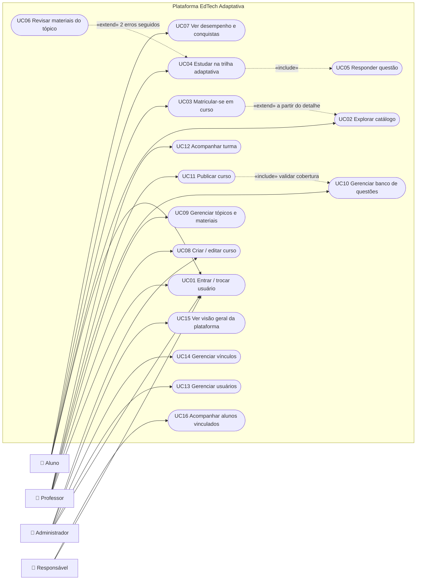

# Casos de Uso

> **Convenção visual:** o Mermaid não possui diagrama de casos de uso UML nativo. Usamos `flowchart`:
> atores são retângulos com 👤 à esquerda; casos de uso são elipses `([ ])` agrupadas pela fronteira do
> sistema (`subgraph`); setas sólidas ligam ator → caso de uso; setas pontilhadas rotuladas
> representam `<<include>>` e `<<extend>>`.

## Diagrama geral

> **Referência histórica** (entrega inicial): o diagrama, a matriz e as descrições UC01–UC16 abaixo refletem perfil único e matrícula pelo próprio aluno (UC03). Para a organização acadêmica valem os casos atualizados da seção final deste arquivo (UC13/UC14, UC16, UC17 e UC18); UC03 foi substituído por matrícula administrativa.

## Matriz ator × caso de uso

| Caso de uso | Aluno | Professor | Admin | Responsável |
|-------------|:-----:|:---------:|:-----:|:-----------:|
| UC01 Entrar / trocar usuário | ✔ | ✔ | ✔ | ✔ |
| UC02 Explorar catálogo | ✔ | | | |
| UC03 Matricular-se em curso | ✔ | | | |
| UC04 Estudar na trilha adaptativa | ✔ | | | |
| UC05 Responder questão | ✔ | | | |
| UC06 Revisar materiais do tópico | ✔ | | | |
| UC07 Ver desempenho e conquistas | ✔ | | | |
| UC08 Criar / editar curso | | ✔ (vinculados) | ✔ (todos) | |
| UC09 Gerenciar tópicos e materiais | | ✔ | ✔ | |
| UC10 Gerenciar banco de questões | | ✔ | ✔ | |
| UC11 Publicar curso | | ✔ | ✔ | |
| UC12 Acompanhar turma | | ✔ | | |
| UC13 Gerenciar usuários | | | ✔ | |
| UC14 Gerenciar vínculos | | | ✔ | |
| UC15 Ver visão geral | | | ✔ | |
| UC16 Acompanhar alunos vinculados | | | | ✔ |

## Descrição dos casos de uso principais

### UC01 — Entrar / trocar usuário (RF01–RF03)
- **Ator:** qualquer perfil.
- **Pré-condição:** usuário ativo cadastrado (no protótipo, usuário de demonstração).
- **Fluxo principal:**
  1. O usuário abre a tela de entrada.
  2. O sistema lista os usuários de demonstração ativos, agrupados por perfil.
  3. O usuário escolhe um usuário.
  4. O sistema abre a área inicial do perfil.
- **Fluxos alternativos:**
  - **A1 — Sair:** o usuário aciona "Sair"; o sistema volta à tela de entrada.
  - **A2 — Acesso indevido:** o usuário acessa o endereço de outra área; o sistema redireciona para a área do seu perfil.

### UC03 — Matricular-se em curso (RF08–RF10) — _histórico; substituído pelo UC18_
- **Ator:** Aluno.
- **Pré-condição:** curso publicado; aluno ainda não matriculado.
- **Fluxo principal:**
  1. O Aluno abre o detalhe de um curso pelo catálogo (UC02).
  2. O Aluno aciona "Matricular".
  3. O sistema cria a matrícula e uma trilha nova com o 1º tópico desbloqueado e domínio 0 em todos os tópicos.
  4. O curso aparece em "Meus cursos" com progresso 0%.
- **Fluxos alternativos:**
  - **A1 — Já matriculado:** o detalhe exibe "Continuar" e leva à trilha (UC04).

### UC04 — Estudar na trilha adaptativa (RF17–RF24, RF25–RF28)
- **Ator:** Aluno.
- **Pré-condição:** aluno matriculado no curso.
- **Fluxo principal:**
  1. O Aluno abre a trilha do curso; o sistema exibe tópicos (bloqueado / desbloqueado / dominado), progresso, XP, sequência e conquistas.
  2. O Aluno aciona "Próxima atividade".
  3. O sistema seleciona o tópico desbloqueado não dominado de menor domínio e uma questão na dificuldade da faixa do domínio.
  4. O Aluno responde (UC05).
  5. O sistema exibe feedback (acerto/erro, alternativa correta, explicação, variação de domínio e XP ganho).
  6. Repete a partir do passo 2.
- **Fluxos alternativos:**
  - **A1 — Tópico dominado (domínio ≥ 80):** o sistema marca o tópico como dominado, desbloqueia o seguinte e concede conquista se for o primeiro.
  - **A2 — Dois erros seguidos no tópico:** o sistema sugere revisão (UC06); o Aluno pode revisar ou continuar.
  - **A3 — Todos os tópicos dominados:** o sistema marca o curso como concluído (100%) e concede a conquista "Curso concluído".

### UC08/UC11 — Criar e publicar curso (RF11–RF16)
- **Ator:** Professor (cursos vinculados) ou Administrador.
- **Fluxo principal:**
  1. O Professor cria o curso informando título, descrição, área e nível; o curso fica como "rascunho".
  2. Adiciona e ordena tópicos e anexa materiais (UC09).
  3. Cadastra questões por tópico com dificuldade, alternativa correta e explicação (UC10).
  4. Aciona "Publicar"; o sistema valida a cobertura de níveis por tópico.
  5. O curso passa a "publicado" e aparece no catálogo.
- **Fluxos alternativos:**
  - **A1 — Título ausente:** o sistema não salva e indica o campo.
  - **A2 — Questão sem alternativa correta:** o sistema não salva a questão.
  - **A3 — Cobertura incompleta:** o sistema não publica e lista tópicos e níveis faltantes.
  - **A4 — Curso não vinculado:** o Professor não consegue editar.

### UC12 — Acompanhar turma (RF30–RF32)
- **Ator:** Professor.
- **Fluxo principal:**
  1. O Professor abre o painel de um curso vinculado.
  2. O sistema exibe alunos com progresso e taxa de acertos, e domínio médio por tópico.
  3. Alunos com < 50% de acertos nas últimas 10 respostas aparecem como "precisa de atenção".
  4. O Professor abre o detalhe de um aluno e vê domínio por tópico e respostas recentes.

### UC13/UC14 — Gerenciar usuários e vínculos (RF04, RF05, RF34)
- **Ator:** Administrador.
- **Fluxo principal:**
  1. O Administrador lista os usuários e cria, edita ou desativa um usuário.
  2. Vincula Responsáveis a Alunos e Professores a Cursos.
- **Fluxos alternativos:**
  - **A1 — Desativação:** o usuário desativado deixa de aparecer na tela de entrada.

### UC16 — Acompanhar alunos vinculados (RF33)
- **Ator:** Responsável.
- **Fluxo principal:**
  1. O Responsável abre seu painel.
  2. O sistema lista apenas os alunos vinculados, com cursos, progresso, sequência de dias e última atividade.

## Organização acadêmica — casos de uso atualizados (change `organizacao-academica`)

Os casos abaixo **substituem** as descrições por perfil único e por curso acima (mantidas como referência histórica) para as telas entregues nas tarefas 7.4, 7.15 e 7.16. Pessoas têm funções cumulativas explícitas (Aluno, Professor, Coordenador, Administrador e Responsável); cada função abre sua própria área, e vínculos nunca concedem funções.

### UC13/UC14 — Gerenciar pessoas, funções e vínculos globais (7.4)
- **Ator:** Administrador (exclusivo; Coordenador, Professor, Aluno e Responsável não alcançam estas telas nem por endereço direto).
- **Fluxo principal:**
  1. O Administrador lista as pessoas (nome, e-mail, funções e situação) e cria ou edita uma pessoa escolhendo uma ou mais funções — por exemplo, Professor e Coordenador na mesma pessoa.
  2. Desativa ou reativa uma pessoa: a desativação não apaga matrículas, respostas ou vínculos.
  3. Em *Vínculos*, atribui ou remove a coordenação de uma graduação e vincula Responsáveis a Alunos.
- **Regras e alternativos:**
  - **A1 — Pessoa ativa sem função:** rejeitada com o motivo; nada é salvo.
  - **A2 — Coordenação sem a função Coordenador** (ou vínculo Responsável–Aluno cujo destino não é Aluno): rejeitado; ninguém concede coordenação a si próprio sem ser Administrador.
  - **A3 — Revogação:** retirar uma função ou vínculo vale na próxima operação, inclusive com telas já abertas; o histórico e os demais vínculos permanecem.

### UC16 — Acompanhar alunos vinculados (7.15)
- **Ator:** Responsável.
- **Fluxo principal:**
  1. O Responsável abre seu painel; o sistema lista **apenas** os alunos vinculados.
  2. Para cada aluno, mostra uma linha por oferta (disciplina, graduação, turma e período) com progresso, sequência de dias e última atividade — duas ofertas da mesma disciplina aparecem separadas.
- **Alternativos:** **A1 — Sem respostas** na oferta: progresso zero, sequência zero e última atividade “Sem atividade”. O painel nunca traz histórico de questões, gabaritos ou XP detalhado.

### UC17 — Consultar a visão geral administrativa (7.16)
- **Ator:** Administrador.
- **Fluxo principal:** o sistema apresenta o total de **pessoas distintas**, as pessoas por função (quem tem duas funções conta uma vez no total e uma vez em cada função), graduações, disciplinas **por estado de publicação** (publicadas e em rascunho), períodos letivos, turmas e matrículas.
- **Regra:** graduações não são contadas como publicadas nem como rascunho — a publicação pertence à disciplina.

### UC18 — Matricular aluno em turma (7.7)
- **Ator:** Administrador ou Coordenador do curso da turma (o Aluno **não** se matricula).
- **Fluxo principal:** em *Gestão acadêmica*, o ator escolhe a turma do seu escopo e um aluno ativo e registra a matrícula na data virtual. A matrícula não depende da publicação do conteúdo, mas o estudo fica indisponível enquanto a disciplina estiver em rascunho.
- **Regras e alternativos:**
  - **A1 — Matrícula repetida:** o sistema informa que o aluno já estava matriculado e preserva respostas, XP e progresso (nada é reiniciado).
  - **A2 — Outro período:** nova matrícula em outra oferta da mesma disciplina começa do zero, sem copiar o histórico.
  - **A3 — Fora do escopo:** turma de outro curso é negada (a coordenação não a vê nem a acessa por endereço direto).
