# Fluxos de Usuário

Jornadas por perfil e diagramas de atividade/sequência dos fluxos principais. Os IDs entre parênteses referem-se a [requisitos.md](requisitos.md) e [casos-de-uso.md](casos-de-uso.md).

## 1. Jornadas por perfil

> **Referência histórica** (entrega inicial `edtech-adaptativa-fase-inicial`): perfil único por pessoa, matrícula pelo próprio aluno e estudo por curso; veja a §7 (Aluno e Coordenação) e a §4.1 (conteúdo) para a organização acadêmica. Não descreve o comportamento atual.

### Aluno
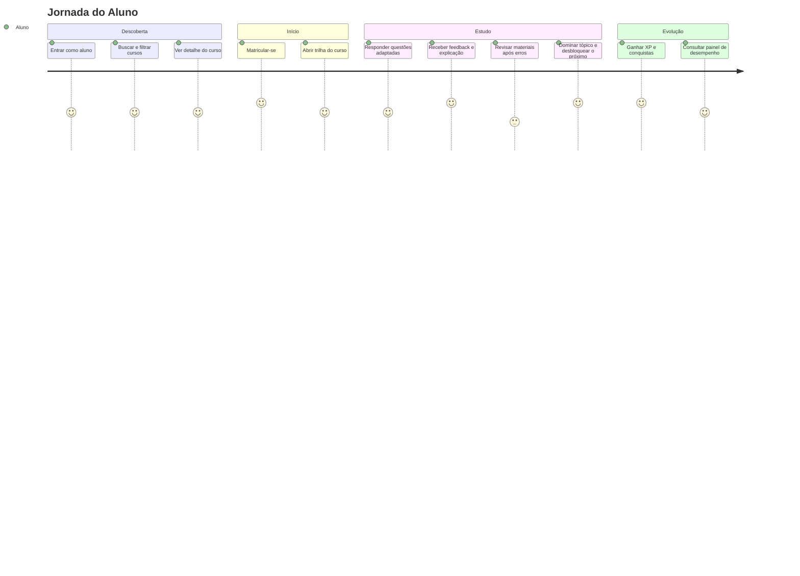

### Professor
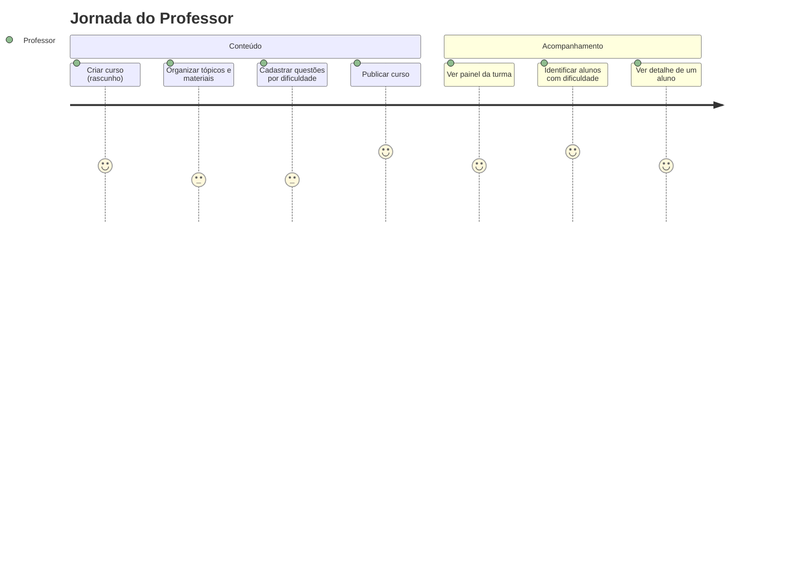

### Responsável
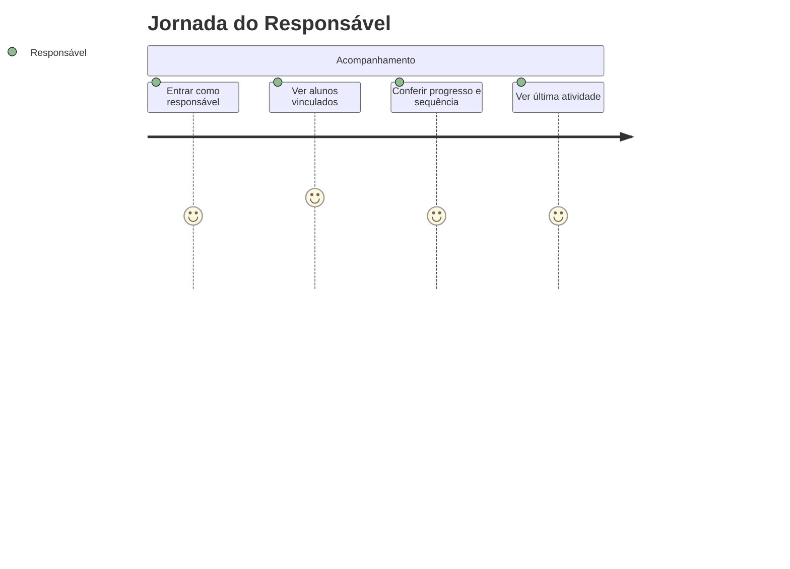

### Administrador
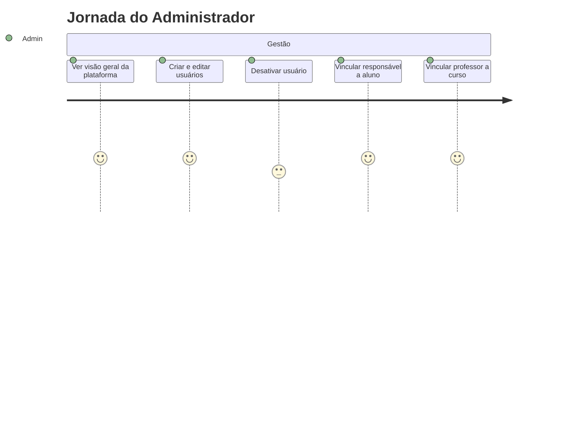

## 2. Matrícula em curso (UC02, UC03 — RF06–RF10)

> **Referência histórica** (entrega inicial `edtech-adaptativa-fase-inicial`): a matrícula direta em curso (automatrícula) foi substituída pela matrícula **administrativa em turma** — veja a §7.2 e o UC18. Não descreve o comportamento atual.

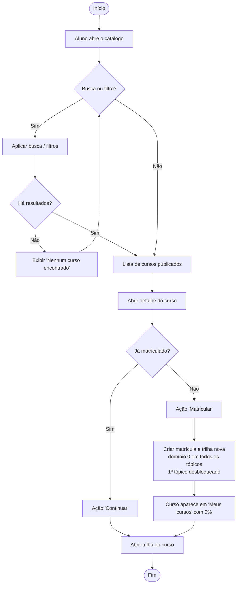

## 3. Sessão adaptativa (UC04, UC05, UC06 — RF17–RF28)

> **Referência histórica** (entrega inicial `edtech-adaptativa-fase-inicial`): as regras numéricas continuam valendo, mas o estudo agora é por matrícula (aluno + turma) — veja a §7.1. Não descreve o comportamento atual.

### Atividade
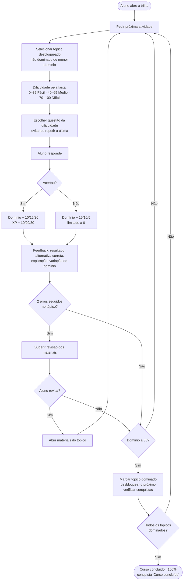

### Sequência
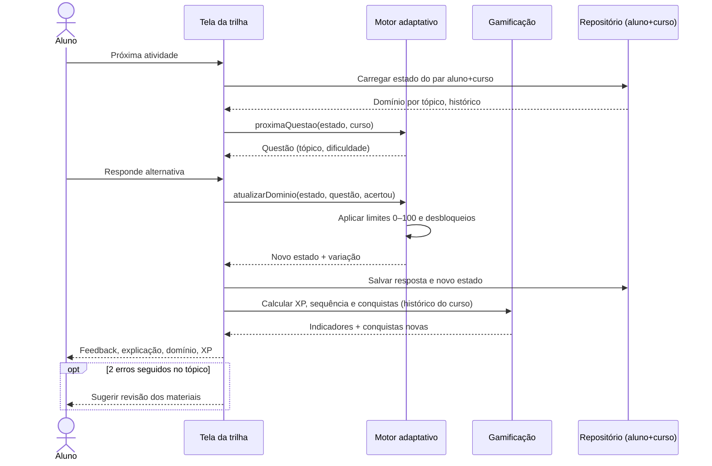

## 4. Criação e publicação de curso (UC08–UC11 — RF11–RF16)

> **Referência histórica** (entrega inicial `edtech-adaptativa-fase-inicial`): o conteúdo agora pertence à disciplina — veja a §4.1. Não descreve o comportamento atual.

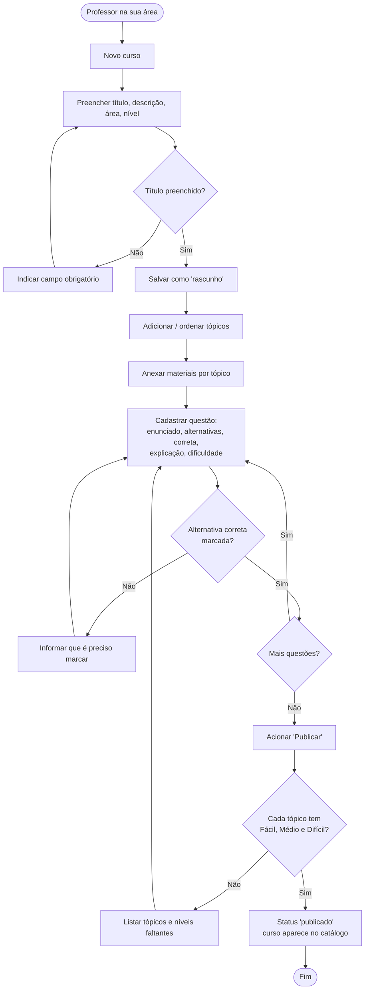

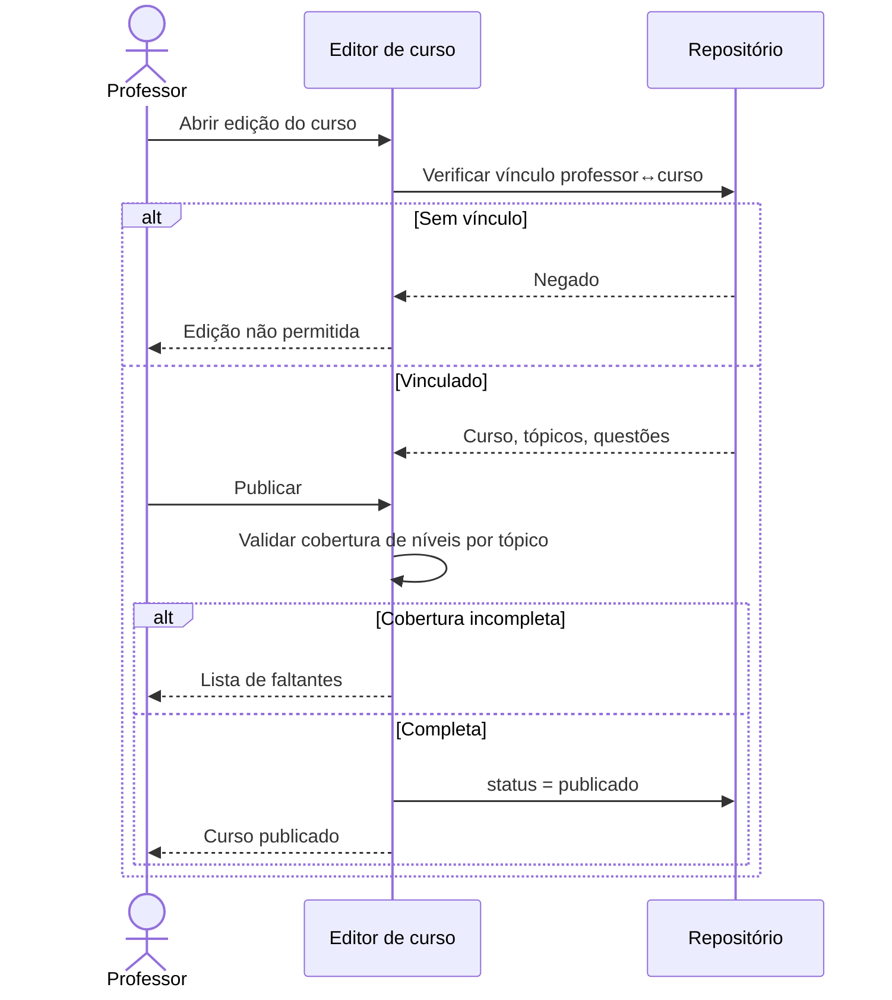

## 4.1 Edição e publicação do conteúdo da disciplina (organização acadêmica — tarefas 4.1–4.7)

Substitui, para a organização acadêmica, o fluxo por curso da seção 4 (mantida como referência histórica): o conteúdo pertence à **disciplina** e é compartilhado por todas as turmas. O editor prepara o conteúdo inteiro e o salva de uma só vez (`salvarConteudo`); a publicação é um comando separado (`publicarConteudo`) e ajustes de material têm comando próprio (`salvarMateriais`).

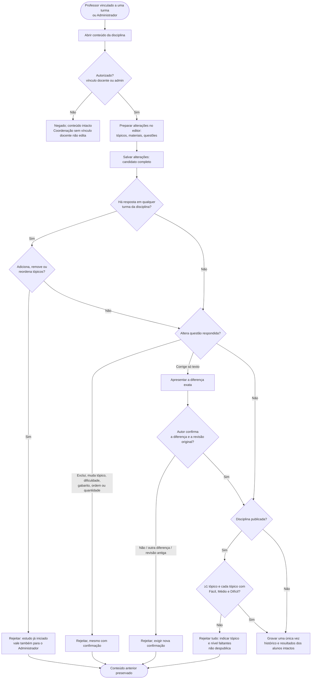

Regras do fluxo:

- **Tudo ou nada.** Uma edição que mistura uma parte válida (por exemplo, correção de material) com outra inválida (por exemplo, remover a única questão Fácil de um tópico) é rejeitada por inteiro: o documento persistido, a publicação e os dados dos alunos permanecem idênticos, e a interface não exibe sucesso. Falha de gravação tem o mesmo efeito.
- **Publicar** exige ao menos um tópico e as três dificuldades em cada tópico; se faltar algo, a disciplina continua em rascunho e a rejeição lista os tópicos e níveis faltantes. A cobertura é verificada de novo em todo salvamento de disciplina já publicada.
- **Confirmação textual.** Apenas enunciado, texto das alternativas e explicação de questão respondida (e título de tópico com respostas) podem ser corrigidos, após o próprio autor examinar a diferença e confirmar que significado e correspondência foram preservados. Não há segundo revisor. Nova alteração, outra diferença ou outra revisão de origem exigem nova confirmação; a confirmação não substitui a autorização de edição. O histórico dos alunos continua exibindo o conteúdo originalmente apresentado.
- **Materiais** podem ser corrigidos a qualquer momento (inclusive com trilhas em andamento ou concluídas) sem alterar tópicos, questões ou resultados.

## 5. Acompanhamento pelo professor (UC12 — RF30–RF32)

> **Referência histórica** (entrega inicial `edtech-adaptativa-fase-inicial`): o painel é por turma vinculada, com médias da turma — veja `requisitos.md` (indicadores por turma). Não descreve o comportamento atual.

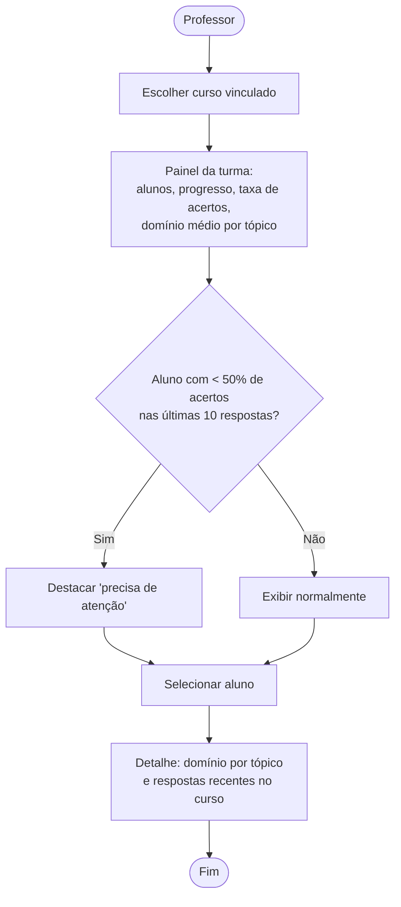

## 6. Acompanhamento pelo responsável (UC16 — RF33)

> **Referência histórica** (entrega inicial `edtech-adaptativa-fase-inicial`): o painel traz uma linha por oferta — veja o UC16 atualizado em `casos-de-uso.md`. Não descreve o comportamento atual.

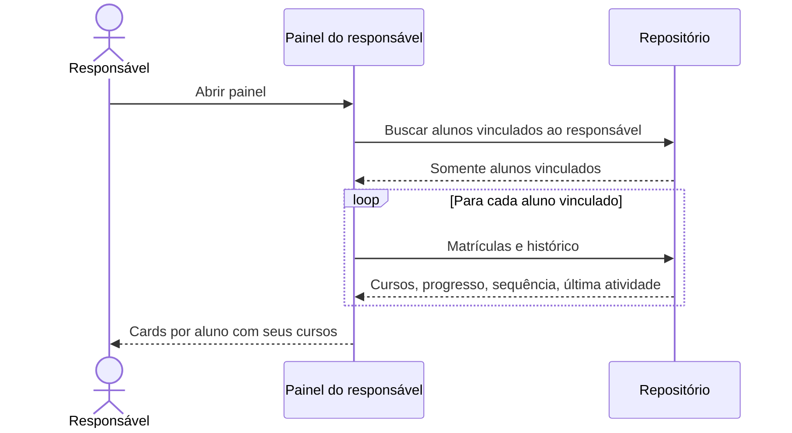

## 7. Jornadas da organização acadêmica (tarefas 7.7 e 7.10)

As jornadas abaixo substituem, para a organização acadêmica, a matrícula em curso (§2) e a sessão por curso (§3): o estudo acontece **por matrícula** (aluno + turma), e a matrícula é um ato administrativo.

### 7.1 Jornada do Aluno (7.10)

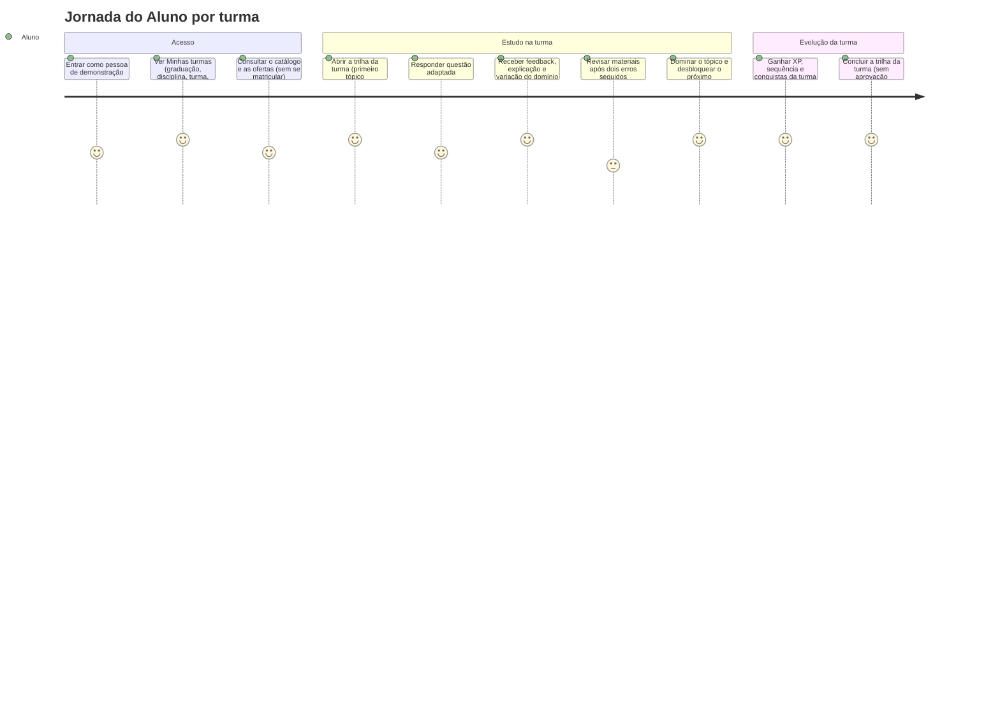

Pontos de atenção: cada turma tem trilha, XP, sequência e conquistas próprios — mesma disciplina em outro período recomeça do zero; a URL do estudo é `/aluno/disciplinas/:disciplinaId/turmas/:turmaId` e IDs que não correspondem a uma matrícula do aluno resultam em acesso negado; turmas cujo conteúdo está em rascunho aparecem sem ação de estudo; URLs antigas por curso levam a *Minhas turmas*, sem escolher uma turma arbitrária. A questão exibida nunca traz gabarito nem explicação antes da resposta.

### 7.2 Jornada da Coordenação (7.7)

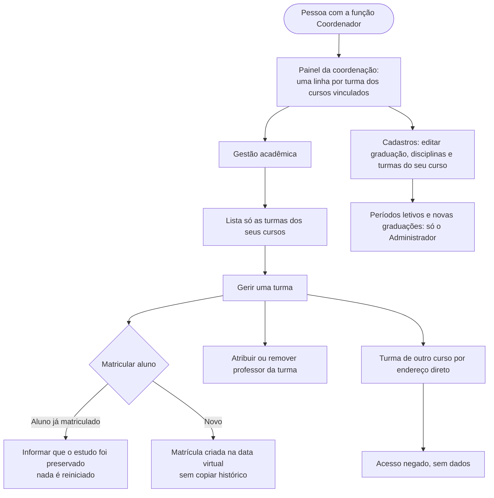

A coordenação gere cadastro, turmas, matrículas e atribuições docentes **do seu escopo**, mas não edita conteúdo pedagógico (sem vínculo docente), não altera resultados de estudo e não vê respostas individuais. Uma pessoa Professor e Coordenador usa duas áreas distintas, cada uma com o seu escopo. O Administrador usa a mesma tela de gestão para qualquer turma.

