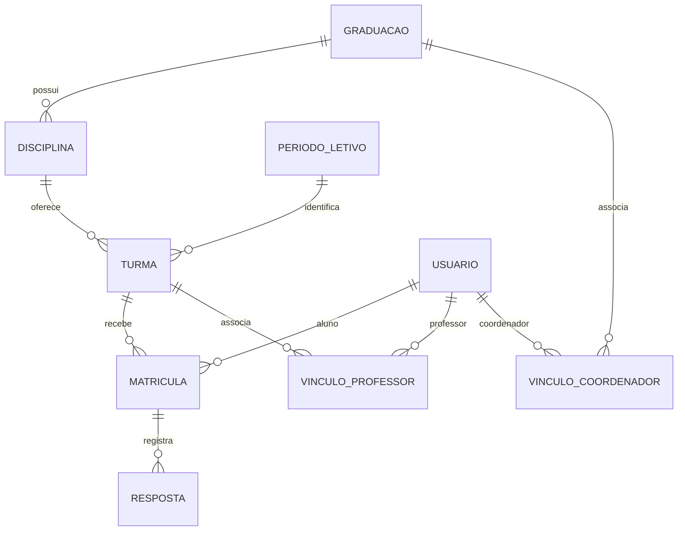

# Design

## Context

Motivação e decisões de produto: [proposal.md](proposal.md). O contrato de comportamento está nas sete [specs desta change](specs/organizacao-academica/spec.md), incluindo as revisões de preservação de resultados, publicação e indicadores. Este documento descreve uma implementação futura; não altera o protótipo nem autoriza arquivamento.

A inspeção do código encontrou os seguintes pontos que condicionam a abordagem:

| Área existente | Comportamento observado | Consequência técnica |
| --- | --- | --- |
| `prototipo/src/dominio/tipos.ts` | `Usuario.perfil` é único; `Curso` contém tópicos; matrícula, resposta e vínculo docente usam `cursoId`. | Separar entidades acadêmicas e substituir perfil único por funções cumulativas. |
| `dados/repositorio.ts` | `obterDados()` entrega o estado completo; operações não verificam sistematicamente o autor; versão diferente ou JSON inválido provoca reposição automática do seed. | Criar consultas autorizadas e comandos com validação; inicialização deve anteceder qualquer reposição dos dados. |
| `salvarCurso`, `salvarQuestao`, `removerQuestao` | Salvam independentemente; remover tópico também elimina suas questões. Cobertura é validada em `publicarCurso`, sem proteção equivalente nas edições seguintes. | Centralizar alterações de conteúdo em uma operação sobre o estado final proposto. |
| `app/contexto.tsx`, `RotaProtegida.tsx`, `Rotas.tsx` | Contexto recebe todos os dados; guard e menus verificam um perfil; URLs identificam curso como unidade de estudo. | Separar sessão de dados de tela e autorizar também cada recurso solicitado. |
| `adaptativo/motor.ts`, `gamificacao/gamificacao.ts` | Funções puras reconstituem domínio e conquistas a partir das respostas; `progressoCurso` já arredonda o progresso. | Reaproveitar funções puras com contexto Aluno–Turma e remover arredondamento dos valores usados em cálculos. |
| `desempenho/indicadores.ts` | Filtragem por aluno–curso; média vazia retorna zero. | Filtrar por turma e representar ausência de matriculados explicitamente. |
| `telas/professor/EditorCurso.tsx`, `Layout.tsx` | Tópicos são salvos imediatamente; restauração não pede confirmação. | Usar edição de conteúdo preparada antes do salvamento e aviso antes de substituir dados locais. |
| Testes e seed | Vitest, Testing Library e MemoryRouter; históricos fictícios gerados pelo motor; testes esperam automatrícula e reposição silenciosa de versão. | Adaptar os contratos alterados e preservar testes das regras ainda válidas. |

`openspec list --specs --json` retornou inventário vazio nesta elaboração. A change inicial continua em `openspec/changes/edtech-adaptativa-fase-inicial/`, com implementação existente, mas sem consolidação em `openspec/specs/`.

## Goals / Non-Goals

**Goals:**

- Tornar a autorização e as invariantes verificáveis no repositório, inclusive quando a operação não parte da tela esperada.
- Preservar resultados históricos sem depender do texto atual de uma questão ou de filtros aplicados informalmente pelas telas.
- Aproveitar React, TypeScript, Vite, React Router, funções puras e testes já existentes, sem dependência obrigatória nova.
- Manter um único formato local coerente, com substituição informada dos dados antigos e rejeição integral de comandos inválidos.

**Non-Goals:**

- Segurança de produção, autenticação real, persistência em servidor ou garantia de integridade contra edição manual do armazenamento pelo usuário.
- Migração automática dos históricos aluno–curso antigos para o modelo acadêmico, versionamento de conteúdo por turma ou introdução de um sistema acadêmico completo.
- Criar regras adicionais de calendário, pré-requisitos curriculares, cancelamento de matrícula ou exclusão de entidades acadêmicas que as specs não definem.
- Resolver o arquivamento das changes ou implementar nesta etapa o design e sua estratégia de testes.

## Decisions

### D1. Entidades acadêmicas com identidade estável e referências explícitas

Substituir o uso técnico ambíguo de `Curso` por `Graduacao` para o cadastro acadêmico; a interface pode continuar usando “Curso” quando o contexto for graduação. O antigo agregado de conteúdo passa a `Disciplina`. Identificadores são opacos e estáveis; códigos e nomes editáveis nunca funcionam como chave de histórico.

| Entidade | Dados principais | Relações e invariantes |
| --- | --- | --- |
| `Usuario` | `id`, nome, e-mail, ativo, `funcoes[]` | Funções sem duplicação; pessoa ativa tem ao menos uma; inclui Coordenador. |
| `Graduacao` | `id`, código, nome, descrição, área | Código único entre graduações; sem tópicos ou estado de publicação. |
| `Disciplina` | `id`, `graduacaoId`, código, nome, descrição curta, descrição, nível, publicação, tópicos ordenados | Uma graduação; código único nessa graduação; inicia em rascunho; nível pedagógico não é período letivo. |
| `Topico` e `Material` | IDs estáveis, título; materiais de texto ou link | Tópicos pertencem à disciplina; materiais permanecem aninhados ao tópico. |
| `Questao` | `id`, `disciplinaId`, `topicoId`, enunciado, alternativas, correta, explicação, dificuldade | Uma disciplina e um tópico dessa disciplina; banco compartilhado entre suas turmas. |
| `PeriodoLetivo` | `id`, nome, início e fim em `AAAA-MM-DD` | Identidade global, nome e datas obrigatórios; fim não anterior ao início. |
| `Turma` | `id`, código, `disciplinaId`, `periodoLetivoId` | Código único por disciplina–período; zero ou mais alunos e professores. |
| `Matricula` | `id`, `alunoId`, `turmaId`, data | Unicidade aluno–turma; aluno ativo com função Aluno na criação. |
| `VinculoProfessor` | `professorId`, `turmaId` | Par único; função Professor e pessoa ativa exigidas na atribuição. |
| `VinculoCoordenador` | `coordenadorId`, `graduacaoId` | Par único; somente Administrador atribui ou remove. |
| `VinculoResponsavel` | `responsavelId`, `alunoId` | Preservar vínculo e escopo já definidos nas specs. |
| `Resposta` | `id`, `matriculaId`, `topicoId`, `questaoId`, alternativa, avaliação, dificuldade, data e ordem | Matrícula resolve aluno e turma; dados de avaliação históricos são imutáveis após o registro. |
| `RevisaoTextual` | autor, data, recurso, diferença aprovada e confirmação humana | Registro técnico da revisão descrita em D5; não cria nova função de usuário. |

Manter coleções separadas para entidades e vínculos em um único documento `DadosAcademicos`, com `versaoSchema`, `versaoSeed`, revisão do documento e `dataVirtual`. Tópicos ordenados e seus materiais continuam dentro da disciplina, evitando reescrever sem necessidade o modelo de edição já existente. Índices por ID e pelos pares únicos podem ser construídos em memória; não são outra fonte persistida.

Aplicar as regras de identidade das ofertas no repositório: matrícula ou resposta impede trocar disciplina/período da turma e graduação da disciplina. Alteração permitida de origem/destino exige autorização para ambos. Repetição de matrícula ou vínculo devolve o resultado existente com informação de duplicidade, sem criar estado de estudo novo.

**Alternativas:** tratar cada turma como cópia do antigo curso duplicaria conteúdo e confundiria vínculo com autoria. Um banco relacional resolveria restrições por chaves, mas introduziria infraestrutura fora desta entrega. Coleções locais e validação centralizada atendem ao volume fictício preservando limites claros para uma futura API.

### D2. Autorizar ações sobre recursos, com funções cumulativas

Centralizar políticas puras em um módulo de autorização, consumido pelas telas e pelo repositório. O repositório resolve a pessoa pela sessão simulada; não aceita funções, identidade do autor ou curso de autorização fornecidos pelo formulário como prova de permissão. A função solicitada por uma rota serve à navegação, não concede privilégios.

Em cada consulta ou comando: reler a sessão e o estado atual, exigir pessoa ativa, resolver o recurso e suas relações e avaliar a combinação função–vínculo que permite aquela ação. Em URLs aninhadas, validar também se turma, disciplina e graduação realmente correspondem entre si. Ao responder, obter o aluno da sessão e a matrícula correspondente; um `alunoId` divergente não pode ser usado para escrever por outra pessoa.

| Ação | Autorização e resultado permitido |
| --- | --- |
| Criar graduação; manter períodos, usuários, funções, coordenação e vínculo Responsável–Aluno | Administrador. |
| Editar dados da graduação; criar/editar suas disciplinas e turmas; matricular e gerir vínculos docentes | Administrador ou Coordenador vinculado ao curso de todos os recursos envolvidos. |
| Editar/publicar conteúdo pedagógico | Administrador ou Professor vinculado a ao menos uma turma da disciplina; os bloqueios de D5 valem para ambos. |
| Consultar catálogo | Função Aluno; retorno de metadados, sem questões ou dados de colegas. |
| Consultar estudo e responder | Aluno da própria matrícula, com publicação e desbloqueio exigidos pelas specs. |
| Consultar painel docente e detalhe das respostas de um aluno | Professor vinculado à turma consultada; aluno deve pertencer à turma. |
| Consultar indicadores da coordenação | Coordenador do curso; somente dados básicos por turma, sem histórico detalhado de respostas. |
| Consultar painel do responsável | Responsável vinculado ao aluno; somente o resumo definido na spec. |
| Consultar visão administrativa | Administrador, com os totais e painéis básicos previstos; não inferir autorização universal para qualquer detalhe futuro. |

Exemplo: Carla, professora em Algoritmos e coordenadora de Direito, pode editar o conteúdo de Algoritmos e administrar matrículas de Direito. A função Professor, sem vínculo docente em Direito, não permite editar seu conteúdo. Seus vínculos de coordenação não autorizam consultar turmas de outro curso onde ela tampouco leciona.

Substituir o `obterDados()` global usado pelo React por consultas com retornos específicos: catálogo, minhas turmas, painel de turma, resumo da coordenação, conteúdo editável e candidatos elegíveis a vínculo. Para atribuições, devolver apenas identidade e funções necessárias à seleção, sem histórico dos candidatos. O estado integral fica privado ao repositório e aos testes. Dados copiados para componentes não são autorização para a próxima operação.

O contexto mantém sessão, funções e estado de inicialização; cada tela obtém sua consulta autorizada. Ao trocar de pessoa, remover função, desativar usuário ou revogar vínculo, invalidar consultas e não renderizar o retrato anterior. Revalidar também na operação seguinte, mesmo que a tela ou o editor esteja aberto. Negação por acesso direto não deve exibir primeiro os dados para depois redirecionar.

**Alternativas:** adaptar apenas o guard de rotas deixaria chamadas diretas ao repositório sem proteção. Um “perfil principal” perderia permissões cumulativas. A união é feita por ação autorizada, sem misturar funções e vínculos de recursos diferentes. Como tudo permanece local, essa autorização é comportamento do protótipo, não uma fronteira de segurança contra ferramentas de desenvolvimento do navegador.

### D3. Isolar estudo pela matrícula e manter avaliações históricas imutáveis

Usar `matriculaId` como referência persistida de contexto e validar sua unicidade aluno–turma. Toda função de estudo recebe o contexto resolvido e filtra respostas por essa matrícula antes de calcular domínio, próxima questão, revisão, progresso ou gamificação. Não aceitar uma lista de respostas de toda a disciplina para depois depender de cada chamador filtrar corretamente.

Reaproveitar as funções puras de `adaptativo/motor.ts` e `gamificacao/gamificacao.ts`, mudando a unidade de conteúdo para disciplina e a de histórico para matrícula. Preservar as regras numéricas das specs e de `adaptativo/config.ts`. Uma nova oferta compartilha conteúdo, mas sua nova matrícula não recebe respostas da oferta anterior. Matrícula duplicada não gera um novo contexto.

No registro de uma resposta, resolver a questão atual, validar matrícula, publicação, tópico desbloqueado, pertencimento da questão e alternativa válida. Guardar a avaliação calculada pelo domínio, não o resultado enviado pela tela. Além dos campos atuais, manter uma cópia dos dados apresentados e avaliados: enunciado, alternativas ordenadas, alternativa correta, explicação, dificuldade, versão das regras e efeitos concedidos de domínio e XP. A ordem `momento` e a data virtual permanecem estáveis.

Essa cópia é um registro da resposta, não uma versão de conteúdo diferente por turma. O histórico detalhado usa os dados da resposta para continuar mostrando o que foi respondido após uma correção textual aprovada. As leituras não reavaliam respostas antigas contra o gabarito ou a dificuldade atuais.

Domínio e gamificação continuam como projeções puras do histórico imutável; não criar contadores editáveis pelas telas. Para domínio, aplicar os efeitos registrados na ordem histórica e manter os tópicos já dominados/desbloqueados conforme os eventos. XP é a soma dos valores concedidos nas respostas. Conquistas têm a data do primeiro evento que satisfaz o marco, nunca a data da consulta ou da edição do material; reconstruir a projeção não concede outra conquista. A sequência usa dias distintos do histórico e a data virtual atual, preservando a regra de dia inteiro sem atividade.

Edições de conteúdo não registram respostas, não alteram efeitos já concedidos, não invocam reavaliação histórica e não notificam conquistas novamente. Consultas podem reconstruir a mesma projeção determinística. Alterar a data virtual pode afetar a sequência, como já previsto, independentemente de uma edição.

**Alternativas:** recalcular acerto a partir da questão atual permitiria alterar XP e domínio retroativamente. Persistir separadamente todos os contadores aumentaria o risco de divergência. O histórico avaliado com projeções puras preserva a abordagem existente e as datas, sem introduzir versões pedagógicas por oferta.

### D4. Separar cadastro acadêmico de conteúdo e salvar o candidato completo

Dividir o atual `salvarCurso` em comandos de cadastro acadêmico e comandos de conteúdo. Editar descrição, nome ou nível da disciplina pela coordenação não deve permitir enviar tópicos, questões ou publicação no mesmo payload. Validar os campos admitidos por ação e rejeitar campos incompatíveis, em vez de copiar um objeto completo vindo da tela.

Manter `localStorage` e o contrato assíncrono do repositório. Toda alteração segue uma seção crítica síncrona, sem `await` entre leitura, autorização, validação e gravação:

1. Ler o documento vigente e a sessão; conferir a revisão usada pelo formulário, para não sobrescrever silenciosamente um conteúdo mais recente.
2. Criar uma cópia candidata; aplicar somente as alterações do comando, sem modificar o retrato publicado no contexto React.
3. Autorizar sobre os recursos reais e validar relações, unicidade, bloqueios históricos, revisão textual e cobertura do candidato inteiro.
4. Serializar e gravar o documento completo em uma única substituição da chave. Só depois atualizar a interface e devolver sucesso.

Validação recusada não chama a gravação; falha na persistência não produz sucesso na tela. Não gravar material primeiro e questões depois quando constituem uma única edição. Os dados dos alunos não fazem parte do payload editável de conteúdo e permanecem idênticos no candidato. Erros de negócio devem identificar campo, tópico ou dificuldade, sem expor histórico de outra turma para justificar o bloqueio.

O editor atual salva tópicos imediatamente e questões em operações separadas. Adotar um rascunho local de edição da disciplina, com tópicos, materiais e questões preparados antes de “Salvar alterações”. Isso permite adicionar, antes do primeiro estudo, um tópico com as três dificuldades de uma só vez em uma disciplina publicada. Descartar esse rascunho não muda o estado de publicação. Disciplina em rascunho pode ter cobertura incompleta; todas continuam sujeitas à validação individual das questões.

Revisões detectam formulários obsoletos e eventos `storage` invalidam consultas entre abas. A seção crítica garante a operação em uma instância; não é uma transação entre várias abas. Não prometer exclusão mútua entre processos com um simples contador de revisão: concorrência de escritores entre abas é um risco explícito desta persistência, tratado em Risks / Trade-offs.

**Alternativas:** gravar cada entidade em uma chave independente exigiria compensação de alterações parciais. Acrescentar um banco ou mecanismo distribuído neste protótipo não é necessário para a operação local prevista. O documento único permite comparar o estado inteiro antes/depois e testar que uma edição recusada não modificou nenhum dado.

### D5. Validar bloqueios de estudo, revisão humana e publicação em todo salvamento

O índice `disciplinaTemResposta` é derivado de todas as respostas e suas matrículas/turmas, não apenas dos alunos que o professor pode consultar. Outra função interna indica se uma questão já foi respondida em qualquer oferta. A decisão pública devolve somente que existe bloqueio; não precisa revelar alunos ou respostas de turmas sem vínculo.

Após a primeira resposta, comparar a sequência de IDs dos tópicos antes/depois: qualquer adição, remoção ou troca de ordem invalida a edição em todas as turmas, mesmo se o autor for Administrador ou estiver trabalhando por uma oferta nova e vazia. Não apagar questões automaticamente como efeito de remover um tópico antes de validar o comando. Para questão respondida, impedir exclusão e mudanças de identidade, tópico, dificuldade ou gabarito, independentemente de revisão textual.

**Decisão confirmada e explicitada em Correção textual de questões respondidas na spec `gestao-conteudo-curso`:** permitir somente correções no enunciado, texto das alternativas e explicação após revisão humana que preserve significado e correspondência das alternativas, sem alterar sua quantidade ou ordem. Não tentar classificar essa equivalência automaticamente por comparação de strings ou por IA. Apresentar a diferença antes da confirmação explícita do próprio autor autorizado; não exigir segunda pessoa nem criar função Revisor.

O comando vincula a confirmação ao recurso, à revisão original e à diferença textual aprovada, com autor e data. Qualquer nova alteração ou mudança da revisão original invalida a confirmação e exige nova apresentação da diferença e nova confirmação. Revalidar também a autorização atual do autor. O repositório verifica essa correspondência, mas a avaliação de sentido é responsabilidade humana. A confirmação não permite mudar identidade, gabarito, dificuldade ou tópico, reordenar alternativas ou excluir questão respondida. Para título de tópico com respostas, usar a mesma confirmação de preservação do significado. O histórico mantém o conteúdo originalmente apresentado em D3, incluindo enunciado, alternativas ordenadas e explicação, sem alterar avaliações, domínio, progresso, XP, conquistas ou datas.

Materiais podem ser ajustados por autores autorizados sem alterar a estrutura dos tópicos nem a avaliação das questões. O payload específico de material não admite campos de questão ou de resultados. Questões ainda sem respostas podem ser editadas e removidas, desde que a cobertura publicada continue válida.

Ao publicar ou salvar qualquer conteúdo de disciplina já publicada, aplicar `verificarPublicacao` ao candidato final, verificando ao menos um tópico e ao menos uma questão válida de cada dificuldade em cada tópico. A contagem deve considerar apenas questões pertencentes à disciplina e ao tópico corretos. Alteração que elimina cobertura é rejeitada, não converte a disciplina em rascunho e não salva as demais partes do mesmo comando. Bloqueios históricos e cobertura são cumulativos: satisfazer um não dispensa o outro.

**Alternativas:** congelar todo texto após resposta eliminaria as correções humanas aprovadas pelo usuário. Aceitar uma confirmação genérica reutilizável permitiria aprovar um texto e salvar outro. Criar aprovação por outro usuário ou um fluxo institucional de revisão acrescentaria regras de produto não definidas. Versionamento por turma não substitui os bloqueios expressamente exigidos nesta entrega.

### D6. Indicadores calculados por turma com precisão antes da apresentação

Consultar primeiro o conjunto de matrículas da turma e calcular uma projeção para cada uma, inclusive sem respostas. Não substituir esse conjunto pelos alunos que responderam nem excluir silenciosamente quem está inativo: as specs usam todos os matriculados. Consultas de coordenação retornam uma linha por turma; filtros de curso, disciplina ou período não produzem uma média global.

Para `N > 0`, `T` tópicos e `d_i` tópicos dominados pelo matriculado `i`:

- Progresso individual exato: `p_i = 100 × d_i / T`; se `T = 0`, usar zero e não concluída.
- Progresso médio: `soma(p_i) / N`, incluindo zero para quem não iniciou.
- Domínio médio do tópico `t`: `soma(dominio(i, t)) / N`, com zero quando o matriculado não iniciou o tópico.

Manter valores numéricos sem `Math.round` no motor e nos agregadores. Como os alunos de uma turma usam a mesma disciplina, o progresso médio também pode ser calculado pela razão equivalente `100 × soma(d_i) / (T × N)`, evitando usar os percentuais já formatados. Só o formatador da interface aplica `Math.round`, que atende ao empate positivo de meio ponto para cima. Médias vazias retornam `null`/estado Sem dados, distinto de uma turma com alunos e média zero.

Exemplos de aceitação que devem orientar os testes: 80 e 0 dão 40; outra turma com 100 e 100 não participa desse cálculo; seis tópicos com contagens dominadas 1, 1 e 4 dão média exibida 33, sem usar 17, 17 e 67; domínio 80/3 é exibido 27, e média de 80 e 5 é exibida 43. Uma turma sem alunos exibe “Sem dados”.

Taxa de acertos e destaque docente continuam usando as respostas da matrícula consultada. Para “Precisa de atenção”, comparar a razão sem arredondamento com 0,5 nas últimas até dez respostas, sem classificar ausência de atividade como dificuldade. Não derivar médias globais para preencher cartões de curso ou graduação. Contagens administrativas de pessoas e entidades continuam distintas desses indicadores.

**Alternativas:** fazer média das barras já arredondadas produziria 34 no cenário em que a spec exige 33. Agrupar respostas de toda a disciplina excluiria quem não iniciou e misturaria ofertas. As projeções por matrícula oferecem a base comum para aluno, professor e coordenação.

### D7. Rotas e telas identificam o recurso acadêmico correto

Manter React Router, substituindo guards de perfil único por guards de funções e consultas autorizadas. Oferecer as áreas das funções da pessoa na mesma sessão; a escolha visual de uma área não remove nem amplia suas outras permissões. Separar o contexto de navegação de qualquer decisão de autorização.

| Área | Direção das rotas e telas |
| --- | --- |
| Entrada | Seleção de pessoa ativa, funções disponíveis, estado de substituição dos dados locais e saída. |
| Aluno | `/aluno/catalogo`, detalhe de graduação e disciplina; `/aluno/turmas/:turmaId/trilha`, `/sessao`, `/desempenho` e `/topicos/:topicoId`. Minhas turmas mostra ofertas distintas; sem automatrícula. |
| Professor | `/professor/turmas/:turmaId`, detalhe `/alunos/:alunoId`; `/professor/disciplinas/:disciplinaId/conteudo` para autoria compartilhada, condicionada a vínculo docente. |
| Coordenador | `/coordenador/cursos/:graduacaoId`, disciplinas, turmas, matrículas e atribuições docentes desse escopo; painel de indicadores por turma. Não reutilizar o editor pedagógico como cadastro acadêmico. |
| Administrador | Cadastros globais, funções e vínculos, incluindo períodos e coordenação; edição de conteúdo da disciplina com as mesmas validações históricas. |
| Responsável | Painel básico dos alunos vinculados, com ofertas e períodos separados; sem detalhe de questões. |

URLs antigas de estudo por `cursoId` não podem ser reinterpretadas como turma ou escolher uma oferta arbitrariamente. Como a base antiga será substituída, redirecionar esses endereços à lista autorizada de turmas/catálogo, sem reconstruir matrícula ou histórico. Validar recursos inexistentes e combinações incompatíveis antes de apresentar o conteúdo.

Adaptar `EditorCurso`, `Turma`, `CursosProfessor`, `useTrilha`, catálogo, painéis e administração para consultas específicas. No editor, exibir o motivo dos bloqueios e a diferença textual que aguarda revisão; o botão desabilitado é apenas orientação, pois a verificação final continua no comando. Após erro de validação, manter a versão publicada visível e o rascunho local corrigível, sem mensagem de sucesso.

**Alternativas:** manter URLs de curso para a trilha conservaria a ambiguidade entre graduação, disciplina e oferta. Uma tela universal com todos os dados e botões ocultos não garantiria o escopo dos retornos nem as consultas por acesso direto.

### D8. Dados fictícios versionados com substituição informada

Separar inspeção da versão e carregamento dos dados. Antes de montar as áreas protegidas, verificar se existe armazenamento compatível. Sem dados anteriores, inicializar a demonstração nova. Com dados antigos, versão incompatível ou JSON inválido, retornar um estado de inicialização que exige aviso antes de qualquer reposição; não reutilizar o fallback destrutivo atual de `ler()`.

Usar uma chave com namespace do esquema acadêmico e manter os dados legados como cópia técnica de recuperação durante a transição. A interface informa que os dados fictícios antigos serão substituídos na demonstração e que seu histórico não será transferido. Confirmar inicia a nova base e encerra a sessão antiga; cancelar não altera as chaves existentes nem abre uma sessão sobre dados incompatíveis. Restaurar a demonstração exige o mesmo aviso de perda das alterações atuais. A cópia técnica de recuperação não aparece como conteúdo do novo catálogo e não constitui migração.

O novo seed usa IDs estáveis e referências válidas, pelo menos duas graduações, duas disciplinas por graduação, dois períodos, turmas paralelas, uma vazia e uma pessoa Professor e Coordenador. Deve incluir conteúdo publicado e rascunho, aluno sem respostas, trilhas em andamento e concluídas, vínculos de Responsável e ofertas da mesma disciplina em períodos distintos. Gerar históricos pelo motor, como já faz `gerarHistorico`, incluindo os dados de avaliação imutáveis; não preencher contadores independentes para produzir um painel visualmente convincente.

Preservar data virtual determinística e os utilitários de datas existentes. As datas dos períodos identificam ofertas; este design não cria restrições de acesso por início/fim, ausentes das specs. Nomes adicionais de cursos e exemplos de materiais podem ser escolhidos na preparação do seed sem mudar suas regras.

**Alternativas:** migrar cada antigo curso para graduação criaria associações institucionais que os dados antigos não contêm. Repor dados automaticamente por versão violaria o aviso prévio. O namespace novo permite rollback técnico sem misturar estados incompatíveis.

### D9. Estratégia de testes baseada nos cenários de aceitação

Reutilizar Vitest, Testing Library, armazenamento injetável no `Repositorio` e `MemoryRouter` de `testes/renderizar.tsx`. Não adicionar framework de testes nem escrever testes nesta etapa. A implementação futura deve ligar cada cenário das specs a um teste ou roteiro de validação explícito; a tabela identifica os grupos e os pontos de maior risco. _(Nota da etapa de implementação: os testes foram escritos nas tarefas 1–8; a ligação requisito → teste/roteiro está em `docs/rastreabilidade.md`.)_

| Fonte e cenários | Nível e evidência esperada |
| --- | --- |
| `organizacao-academica`: criação, referências inválidas, códigos duplicados, matrículas repetidas, vários vínculos, identidade da oferta | Testes de domínio/repositório que conferem unicidade, relações e ausência de mudanças de estudo em duplicação ou renomeação. |
| `perfis-acesso`: acesso direto, funções cumulativas, coordenação de outro curso, revogação/desativação | Testes das políticas e das consultas/comandos sem depender de componentes; testes de rota comprovam ausência de exposição transitória e dados da sessão anterior. |
| `gestao-conteudo-curso`: estudo em A e edição por B, aluno concluído, gabarito/dificuldade, revisão textual | Estado de várias turmas antes/depois; todas as operações proibidas são rejeitadas também para Administrador. Confirmar que revisão humana não contorna campos imutáveis nem vale para outra diferença ou revisão. |
| `gestao-conteudo-curso`: edição válida, perda de cobertura, disciplina sem tópicos e falha no conjunto | Comparar o documento persistido inteiro; na rejeição, conteúdo, publicação e dados dos alunos devem permanecer idênticos. Simular também falha de gravação e ausência de sucesso na interface. |
| `aprendizado-adaptativo` e `gamificacao`: isolamento, retomada, preservação, conquistas e datas | Funções puras com contextos de dois alunos, duas turmas e dois períodos; edição segura e rejeitada preservam projeções e registros, incluindo conclusão e primeira data de cada conquista. |
| `acompanhamento-desempenho`: 80/0, outra turma, precisão, domínio e turma vazia | Casos numéricos independentes da implementação, verificando valores antes de formatar e depois; matrículas sem respostas devem compor o divisor. |
| `catalogo-cursos`: rascunho, filtros, ofertas e ausência de automatrícula | Consultas e componentes verificam os metadados retornados, ações disponíveis e turmas com mesmo nome em períodos distintos. |
| Restauração e substituição de dados | Preparar armazenamento antigo e incompatível; comprovar que a inspeção não escreve, cancelar preserva os dados e confirmar substitui a demonstração e encerra a sessão. |

Os testes atuais de independência, dificuldades, feedback e sequência continuam úteis. Os testes de automatrícula, perfil único e reposição silenciosa devem ser substituídos pelos cenários novos, não mantidos como exigências incompatíveis. Fixtures de agregação podem representar estados sintéticos isolados; seed e testes de fluxo devem usar históricos alcançáveis pelo motor. Na revisão, verificar especialmente exemplos de progresso e XP que não possam ser obtidos juntos pelas regras, sem ajustar as regras para acomodar a fixture.

Na etapa de implementação, os comandos existentes `npm test` e `npm run build`, junto com a validação estrita do OpenSpec, serão verificações distintas: comportamento, tipagem/build e estrutura dos artefatos. Passar o validador do OpenSpec não comprova autorização, atomicidade ou preservação dos dados no aplicativo.

### D10. Reconciliação das specs antes da consolidação

Manter a situação registrada no proposal: a base consolidada está vazia, portanto os sete arquivos atuais são adições formais. Não inventar uma base nem consolidar duas versões incompatíveis como requisitos simultâneos.

Antes de arquivar esta change, a inicial precisa ser revisada e consolidada em ação separada e autorizada. Em seguida, reler a base efetiva e reconciliar cada requisito das seis capacidades herdadas: comportamento novo em `ADDED`; bloco completo atualizado, com nome exato da base, em `MODIFIED`; mudança apenas de nome em `RENAMED`; substituição em `REMOVED` com `Reason` e `Migration`. Requisitos inalterados continuam na base. `organizacao-academica` permanece nova se não tiver sido introduzida por outra ação.

Conferir explicitamente as exigências antigas de perfil único, automatrícula e trilha/XP/painéis por curso; nomes novos não removem os antigos. Preservar as regras básicas ainda válidas. Atualizar a classificação das capacidades no proposal e os deltas de requisitos e cenários juntos, validar a base resultante e revisar a correspondência com a implementação antes de solicitar arquivamento. Essa reconciliação é uma dependência pendente; não é realizada nem autorizada por este design.

**Alternativas:** arquivar a inicial automaticamente ultrapassaria a autorização desta etapa. Ajustar somente o proposal deixaria requisitos antigos ativos, mesmo com um design tecnicamente coerente.

## Risks / Trade-offs

- [Autorização local pode ser contornada fora da interface] → Tratar como protótipo fictício; manter políticas no repositório para verificar comportamento e reutilizá-las quando houver uma API, sem apresentar isso como autenticação de produção.
- [Revisão humana pode aprovar uma alteração de sentido incorretamente] → Exibir diferença e contexto, vincular confirmação ao conteúdo exato e manter dados originais das respostas; campos de avaliação e estrutura não têm exceção por revisão humana.
- [Autores de turmas diferentes editam o mesmo conteúdo] → Autorização pela disciplina para autoria, bloqueio baseado em todas as ofertas e revisão do documento para recusar formulário obsoleto, sem expor históricos não autorizados.
- [Dois escritores em abas diferentes podem disputar `localStorage`] → A operação local usa seção crítica e única gravação; eventos e revisão reduzem estado obsoleto, mas não garantem exclusão mútua entre abas. Se escrita simultânea entre abas for exigida, definir e testar um bloqueio compartilhado ou persistência transacional antes de oferecer essa garantia.
- [Uma edição parece segura na tela, mas remove cobertura no estado final] → Validar o candidato completo no repositório e testar rejeição de todas as partes, incluindo um material válido enviado com uma questão inválida.
- [Reconstituir histórico usando cadastro atual altera resultados ou datas] → Usar avaliações e efeitos imutáveis, IDs estáveis, bloqueios de tópicos e primeira ocorrência dos marcos. Não executar reavaliação histórica em uma edição.
- [Arredondamento intermediário ou exclusão de quem não iniciou distorce o painel] → Separar cálculo e formatação; testar 80/0, seis tópicos com contagens 1/1/4 e turma vazia.
- [Substituição automática apaga a demonstração antes de informar] → Inicialização sem efeitos de escrita até a confirmação, namespace novo e recuperação técnica dos dados legados.
- [Custo de reconstrução de conquistas cresce com o histórico] → Usar uma passagem ordenada por matrícula, evitando o recálculo de todos os prefixos feito hoje; índices/projeções temporárias podem ser descartados, sem alterar o registro histórico.
- [Base inicial não consolidada torna os deltas atuais inadequados ao arquivamento futuro] → Cumprir D10 e a dependência do proposal antes de consolidar esta change.

## Migration Plan

A implementação futura deve introduzir o modelo e os comandos autorizados, adaptar as consultas e telas e preparar o novo seed antes de ativar o novo formato. O formato acadêmico não deve ser lido como se fosse o antigo `Dados`, nem o antigo `Curso` deve ser reinterpretado como graduação com histórico herdado.

Na primeira abertura da versão nova com dados legados, apresentar o aviso e aguardar confirmação antes de iniciar a base acadêmica. Após confirmar, gravar o documento novo completo, invalidar a sessão anterior e abrir a entrada da demonstração. Em cancelamento ou falha de gravação, manter o armazenamento anterior recuperável e não exibir um estado acadêmico parcialmente inicializado.

Para rollback técnico, voltar ao código anterior junto com seu namespace de dados legado preservado; a versão anterior não deve tentar consumir a base acadêmica. Isso não transporta para a versão antiga o estudo realizado no novo modelo. O rollback de uma edição individual recusada é a ausência de gravação, sem operações compensatórias que possam modificar conquistas ou históricos.

Antes do arquivamento, cumprir a reconciliação de D10 em etapa separada. Nesta entrega documental não são executados migração, build do protótipo, testes comportamentais, consolidação, commit ou push.

**Nota da etapa de implementação (tarefas 1–8).** O plano acima foi seguido: modelo e comandos autorizados, consultas, telas e seed novos, com inicialização separada da inspeção, namespace `trilha-adaptativa:academico:*` e preservação do legado como cópia técnica. Os testes e o build foram executados (`docs/validacao-final.md`). A consolidação da base inicial, a reconciliação de D10 e o arquivamento foram executados em ações separadas e autorizadas; a validação estrutural (`openspec validate --strict`) passou, sem provar comportamento.

## Open Questions

Não há decisão de produto pendente para os fluxos especificados após a confirmação da revisão humana. Nomes adicionais e textos dos materiais fictícios podem ser definidos ao preparar o seed sem mudar o contrato. Aprovação obrigatória por segunda pessoa, calendário com bloqueio de acesso e suporte garantido a escritores simultâneos em múltiplas abas não estão definidos; não devem ser introduzidos implicitamente como requisitos desta entrega. Se solicitados, exigirão revisão explícita de escopo antes de implementar esses comportamentos.
